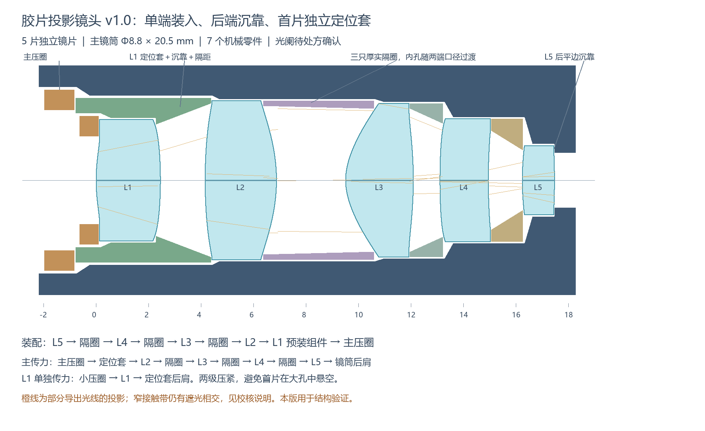

# Optomech Workflow

[English](README.en.md)

**A reviewable optical-to-mechanical workflow, with editable SolidWorks output.**

从光学文件出发，先推理装配，再生成镜筒、隔圈、压圈和沉靠结构。提供六个案例、三维预览、已检查截面图、装配讲解、文件初检和 SolidWorks VBA 生成器。

这是工程初稿工作流。装配方案包含人工 / AI 判断；目前不宣称能为任意 STEP 自动完成机械设计。

## 六个公开案例

| 案例 | 结构 | 验证状态 |
|---|---|---|
| [胶片投影](examples/film-projection/DESIGN.md) | 5 片独立镜片；单端装入；首片定位套；7 个机械件 | 用户已验证 SolidWorks 2023 能生成可用初稿；接触带通光仍待改进 |
| [定焦投影 PF-2](examples/fixed-projection/DESIGN.md) | 10 片 / 8 组；前三片独立沉靠点胶；中央光阑；6 个机械件 | 用户已验证生成、点胶孔与分类配色；仅第三片机械外缘修订 |
| [显微物镜 63X](examples/micro-objective/DESIGN.md) | 五个短镜框台面预装，再统一入筒；7 个机械件 | 用户已运行检查通过 |
| [手机 6P](examples/phone/DESIGN.md) | 三个孔径台阶、矩形隔圈、胶接尾环；5 个机械件 | 用户已运行检查通过 |
| [单反 v5](examples/slr/DESIGN.md) | 三个厚壁外筒、三个内部镜框、四个隔圈；13 个机械件 | 用户已运行检查通过 |
| [广角](examples/wide-angle/DESIGN.md) | 两筒、三个矩形隔圈、一体光阑；8 个机械件 | 用户已运行检查通过 |



## 启动本地工作台

需要 Python 3.10 或更新版本。网页、解析器和宏生成器只用 Python 标准库，无需 pip 安装依赖；预览不需要 SolidWorks。

```sh
python server.py
```

Windows 也可以双击 `start_windows.cmd`。浏览器打开 `http://127.0.0.1:8765`。端口被占用时运行 `python server.py --port 8766`。

## 发布在线展示页

已提供 GitHub Pages 静态导出器与 `.github/workflows/pages.yml`。创建 `yogurt-lt/optomech-workflow`、上传项目后，在仓库 Settings → Pages 中选择 GitHub Actions。首次部署与更新步骤见[部署指南](docs/GITHUB_PAGES.md)。预期地址在部署成功后为 `https://yogurt-lt.github.io/optomech-workflow/`。

静态版保留中英切换、六个案例、三维预览、截面和宏 / Skill 下载；本地版保留文件分析和修改版宏生成。运行 `python tools/build_pages.py` 可导出至 `dist/`。目前交付发布文件，不代表已替用户创建仓库或完成上线。

工作台先展示三维预览，随后讲解装入顺序、固定方式和压紧力路径。02 部分直接显示各案例已检查的截面原图，可放大、下载；默认下载的是对应的已验证宏，保留其专用孔槽。

页首 **English / 中文** 按钮可切换界面、六个案例的介绍与装配讲解、截面图及设计说明，语言选择保存在本地。英文截面图由同一份方案几何生成，不改变 CAD 模型。侧栏还可下载独立的工作流 Skill。

“高级工具”中可编辑各机械零件的 (Z, 半径) 顶点、检查截面交叠、导入/导出方案 JSON、生成修改版主体宏。编辑会同步三维预览，静态截面图保留为基准。通用修改版生成器不自动复现新案例的全部专用孔槽，请以原案例宏为基础细化。保存的 JSON 是后续复现与讨论的核心记录。

“分析新系统”支持 STEP 实体定义和面编号初检，配合顺序模式 Zemax 可识别胶合组、光阑和基于口径顺序的装配候选。它不会直接把未经审查的新文件变成可生产结构。

## 在 SolidWorks 中体验

需要用户自行安装 SolidWorks，当前实机验证版本为 **2023**。打开 VBA 编辑器，导入相应 `.bas`，保存宏后运行模块的 `main`。不直接把 `.bas` 当作 `.swp` 运行。

- 胶片案例：`examples/film-projection/OptomechFilm.bas` → `OptomechFilm.main`
- 定焦案例：`examples/fixed-projection/OptomechFixed.bas` → `OptomechFixed.main`
- 定焦案例含全部镜片参考体（仅第三片修订）：`OptomechFixedWithBlanks.bas` → `OptomechFixedWithBlanks.main`
- 网页导出的宏：`Optomech_Web.bas` → `Optomech_Web.main`

宏在其所在目录新建带时间戳的输出文件夹，生成原生截面草图、旋转特征和机械装配体。组件按坐标固定，不使用装配配合。截面可编辑，但尚未完全尺寸约束。螺纹为名义包络，没有真实牙型与配合公差。

**PF-2 完整参考版已含 10 片镜片，不能与原 STEP 同时叠加。第三片机械外缘已修订。** 原 STEP 保留用于对照；精确光学面以原处方为准，毛坯参考体使用近似折线剖面。

## 命令行

```sh
python -m optomech analyze --step examples/fixed-projection/source.STP --zmx examples/fixed-projection/source.zmx
python -m optomech check examples/fixed-projection/plan.json
python -m optomech generate examples/film-projection/plan.json -o generated/Film.bas
python -m optomech generate examples/fixed-projection/plan.json -o generated/Fixed.bas --blank-references
python tools/build_fixed_demo.py
python -m unittest discover -s tests -v
```

解析 Zemax 文本不执行求解器、多重配置求值、玻璃库或光线追迹。只接受 MM 顺序模式及 STANDARD / EVENASPH 面；STEP 面编号关联目前针对示例所用的 Zemax/HOOPS 导出格式。新系统须另行验证坐标变换与实体几何。文件中的 DIAM/MEMA 不自动等同于可加工、可遮挡的机械边缘。

## 推荐工作流

1. 读取处方及实体，核对镜片顺序、口径、胶合界面、光阑与坐标。
2. 确定装入方向、沉靠和传力路径；口径排序只是装配候选依据。
3. 先画二维截面，检查真实曲面与边缘间隙，再确定镜筒、隔圈和压圈。
4. 将工程判断写进方案 JSON 和设计说明；用统一生成器输出宏。
5. 在 SolidWorks 运行，核查实体、装入路径、接触与通光，再逐步补充公差和加工细节。

与 AI 协作时可参考 [交接提示词](docs/AI_WORKFLOW.md)。没有绑定特定模型、账号、API 或付费服务。

## 可下载 Skill

`skills/optomech-design/` 将本项目的装配推理、加工与装配反馈、SolidWorks 2023 API 经验整理为可复用 Skill，附独立 Python 分析、截面校核和基础宏生成工具。它不包含私人对话或公司镜头数据，也不要求依赖完整案例仓库。可通过网页下载，或直接复制该目录；见[使用说明](docs/SKILL_USAGE.md)。

## 检查范围

程序可阻止无效、自交的机械截面，并采样检查机械—机械和机械—玻璃相交。采样通过不等于实体内核验证通过，也没有完成公差、强度、预紧、热变形和杂散光分析。网页修改后，原案例的通光统计不再代表新方案。

胶片案例的导出光线基准检查已保存在 `plan.json` 和设计说明中；网页不执行光学求迹。PF-2 的明确光阑来自处方，未根据光线外形猜测光阑。

## 项目范围与发布

仓库仅包含六个明确选定的公开案例和通用实现，不包含早期公司产品案例或其输出。STEP 副本中的本机文件路径和导出用户名已清除，ZDA 缓存与本机 CAD 输出不入库。原始工作目录中的文件保持不变。

代码、文档和本仓库提供的示例按 MIT 许可证发布。未附带 SolidWorks、OpticStudio 或玻璃库软件。正式公开前请维护者审阅案例文件与作者署名；项目尚未自动推送至任何 GitHub 仓库。

## Roadmap

- [x] 六个案例的 SolidWorks 实机运行检查
- [x] 三维预览、截面图与装配讲解
- [ ] 通用 STEP 内核导入与修剪曲面提取
- [ ] 光线包络与接触带联动校核
- [ ] 装配路径与制造特征的更完整验证
- [ ] 公差、倒角、螺纹和扳手接口
- [ ] 可选 AI 方案建议接口

欢迎提交带有可公开输入文件、软件版本、方案 JSON 和错误日志的问题。详见 [贡献说明](CONTRIBUTING.md)。

### 3D assembly preview

The local workbench includes an offline, rotatable solid-of-revolution preview for all six demos. Drag to orbit, scroll to zoom, switch between half-section and full views, or hide the barrels. Part colors follow each plan where explicitly provided, including the three distinct SLR barrels. Assembly instructions explain the insertion order, fastening method and load path. Section images remain the reviewed baseline. Glue ports and thread details are represented in CAD rather than in the revolved web preview.
